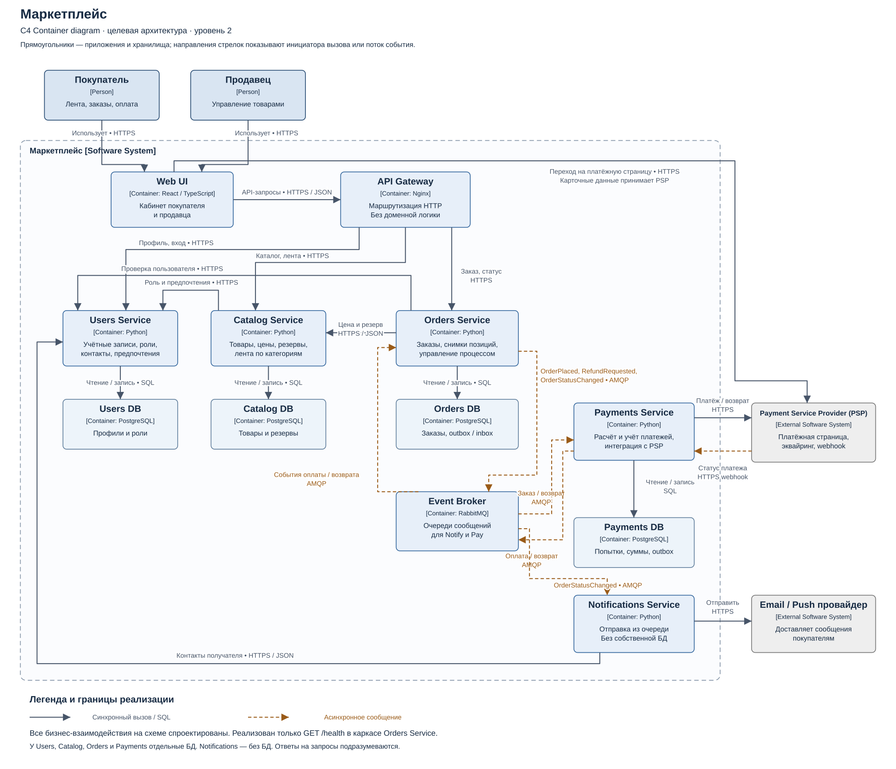

# 1. C4 Container — 2 балла

На диаграмме показаны покупатель, продавец, части маркетплейса, отдельные БД и внешние провайдеры, включая Delivery Service. Стрелки показывают, кто с кем взаимодействует и по какому протоколу.

[PNG](container.png) · [Исходник PlantUML](container.puml)

C4 Container — приложение или хранилище данных. Диаграмма описывает проект всей системы; реализован только `/health` сервиса Orders.
