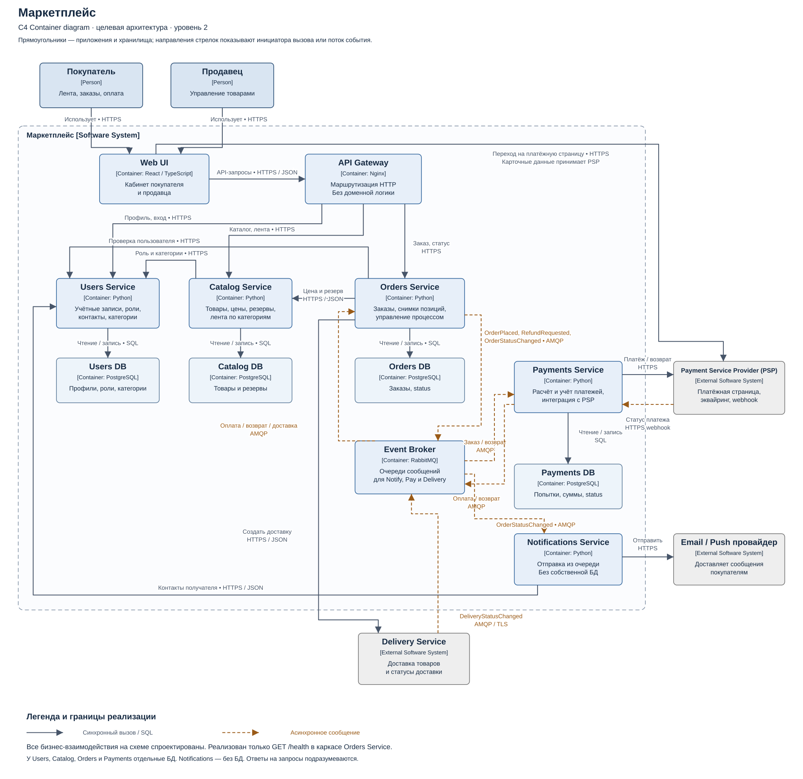

# Маркетплейс — домашнее задание 1

Краткий отчёт по восьми критериям задания. Реализован только технический каркас Orders с `/health`; остальная архитектура спроектирована.

| Пункт | Баллы | Раздел |
|---|---|---|
| 1 | 2 | [C4-диаграмма](#criterion-1) |
| 2 | 2 | [Сервис и запуск](#criterion-2) |
| 3 | 1 | [Домены и ответственность](#criterion-3) |
| 4 | 1 | [Домены по сервисам](#criterion-4) |
| 5 | 1 | [Данные и взаимодействия](#criterion-5) |
| 6 | 1 | [Варианты архитектуры](#criterion-6) |
| 7 | 1 | [Плюсы и минусы](#criterion-7) |
| 8 | 1 | [Финальный выбор](#criterion-8) |

<a id="criterion-1"></a>

## 1. C4 Container — 2 балла

На диаграмме показаны покупатель, продавец, части маркетплейса, отдельные БД и внешние провайдеры, включая Delivery Service. Стрелки показывают, кто с кем взаимодействует и по какому протоколу.



[PNG](diagram/container.png) · [Исходник PlantUML](diagram/container.puml)

C4 Container — приложение или хранилище данных. Диаграмма описывает проект всей системы; реализован только `/health` сервиса Orders.

<a id="criterion-2"></a>

## 2. Сервис в Docker — 2 балла

В папке `service` два файла:

- `app.py` — Python-программа: на запрос `/health` отвечает `200 OK` и текстом `OK`. На остальные адреса — `404`. Бизнес-логики нет.
- `Dockerfile` — инструкция Docker: взять Python, скопировать программу и запустить её в контейнере.

Нужны установленные Docker и curl. Из корня репозитория перейдите в папку сервиса:

```bash
cd service
```

Соберите образ и запустите его:

```bash
docker build -t hw1-orders .
docker run --rm -p 127.0.0.1:18080:8080 hw1-orders
```

Первая команда собирает образ с программой. Вторая запускает контейнер; `-p` связывает порт `18080` вашего компьютера с портом `8080` программы. `--rm` удаляет контейнер после остановки.

Для проверки откройте второй терминал на том же компьютере и выполните:

```bash
curl -i http://localhost:18080/health
```

В ответе будут `200 OK` и текст `OK`. Остановка — **Ctrl+C** в терминале, где запущен контейнер. Для повторного запуска достаточно команды `docker run` выше.

<a id="criterion-3"></a>

## 3. Домены и ответственность — 1 балл

Домен — область задач бизнеса. Внутри маркетплейса выделены шесть доменов; доставка поручена внешнему перевозчику:

| Домен | За что отвечает |
|---|---|
| Пользователи | Профили, роли и контакты покупателей и продавцов |
| Каталог | Товары, цены, остатки и резервы; изменение товаров продавцами |
| Персональная лента | Подбор товаров из последних категорий пользователя и подгрузка при прокрутке |
| Заказы | Состав заказа и его статусы |
| Платежи | Расчёт суммы, учёт оплаты и возвратов |
| Уведомления | Сообщения об изменении статуса заказа |

Users хранит список последних категорий пользователя, например `[1, 5, 7]`. Catalog выбирает из них до 100 товаров (`category_id IN (1, 5, 7)`, `LIMIT 100`). При прокрутке загружается следующая порция по курсору после последнего показанного товара. Если список категорий пуст, используется общая лента.

<a id="criterion-4"></a>

## 4. Домены по сервисам — 1 балл

Сервис — отдельная запускаемая программа. Шесть доменов распределены по пяти внутренним сервисам:

| Сервис | Домены | Почему так |
|---|---|---|
| Users | Пользователи | Один владелец профилей и контактов |
| Catalog | Каталог и персональная лента | Простая лента использует те же товары и категории |
| Orders | Заказы | Координирует оформление и передачу внешнему Delivery Service, хранит состав и статус заказа |
| Payments | Платежи | Отдельный учёт денежных операций и связь с Payment Service Provider (PSP) |
| Notifications | Уведомления | Повторяет отправку независимо от оформления заказа |

Один домен не обязательно равен одному сервису. Каталог и лента объединены, чтобы не добавлять лишние сетевые вызовы и отдельную БД для простой выборки товаров по категориям.

<a id="criterion-5"></a>

## 5. Владение данными и взаимодействия — 1 балл

### Данные

У Users, Catalog, Orders и Payments **отдельные PostgreSQL БД**. Только её владелец читает и изменяет таблицы; остальные обращаются через API или события.

| Владелец | Данные и ответственность |
|---|---|
| Users | Профили, роли, контакты, список последних категорий пользователя |
| Catalog | Товары, цены, остатки, резервы и формирование ленты |
| Orders | Заказы, status, идентификаторы покупателя и доставки, снимки позиций |
| Payments | Суммы, попытки оплаты, status и возвраты |
| Notifications | БД нет: получает сообщения из очереди и отправляет уведомления; шаблоны в коде |

Notifications получает контакты из Users и не хранит историю отправок. Сообщение подтверждается брокеру после успешной передачи провайдеру; при сбое возможен повторный пуш.

Цена в заказе — историческая копия: изменение товара в Catalog не меняет старый заказ. Это допустимое дублирование, а не общая БД.

### Связи

PSP — Payment Service Provider, внешний платёжный сервис. Delivery Service — внешний перевозчик, владеющий данными доставки.

**Синхронно** — вызывающий ждёт ответ. **Асинхронно** — результат обрабатывается позже.

| Кто → кому | Способ | Зачем |
|---|---|---|
| UI → Gateway → Users / Catalog / Orders | HTTPS, синхронно | Профиль, каталог, оформление и статус заказа |
| Catalog → Users | HTTPS, синхронно | Получить последние категории пользователя и роль продавца |
| Orders → Users / Catalog | HTTPS, синхронно | Проверка покупателя, цена, создание и проверка резерва |
| Orders → Payments | RabbitMQ, асинхронно | Начать оплату или возврат |
| Payments → Orders | RabbitMQ, асинхронно | Ссылка на оплату и её результат |
| Orders → Notifications | RabbitMQ, асинхронно | OrderStatusChanged — изменение статуса заказа |
| Orders → Delivery Service | HTTPS, синхронно | Передать заказ после подтверждения оплаты и резерва |
| Delivery Service → Orders | RabbitMQ, AMQP/TLS, асинхронно | DeliveryStatusChanged (orderId, deliveryId, status) |
| Notifications → Users / провайдер уведомлений | HTTPS, синхронно | Получить контакт и отправить сообщение |
| Payments → PSP | HTTPS, синхронно | Создать платёж или возврат |
| PSP → Payments | HTTPS webhook, асинхронно | Подтвердить результат оплаты |
| UI → PSP | HTTPS, переход на страницу | Ввести платёжные данные |

По DeliveryStatusChanged Orders обновляет status заказа и публикует OrderStatusChanged для Notifications. Допускаем, что Delivery Service умеет AMQP/TLS и имеет доступ только к своему каналу публикации.

Catalog не подключён к брокеру. Он возвращает срок резерва; Orders по этому сроку проверяет его состояние через HTTP и отменяет неоплаченный заказ после подтверждённого истечения. При сетевой ошибке проверка повторяется.

Заказ получает согласованную цену из Catalog. Payments считает сумму в копейках по этому снимку; данным о сумме из браузера не доверяет. При смене цены покупатель подтверждает её до отправки заказа на оплату.

Повторные сообщения обрабатываются без повторного списания. При поздней оплате после истечения резерва оформляется возврат. Сбой уведомлений не отменяет заказ. При отказе Users публичная лента доступна без персонализации, а защищённые операции закрыты.

<a id="criterion-6"></a>

## 6. Варианты архитектуры — 1 балл

**А. Модульный монолит.**

**Б. Пять сервисов.**

Разбирались на лекции.

<a id="criterion-7"></a>

## 7. Плюсы и минусы вариантов — 1 балл

| Вариант | Плюсы | Минусы |
|---|---|---|
| Модульный монолит | Проще запускать и отлаживать; заказ и резерв можно сохранить одной транзакцией | Все модули выпускаются и масштабируются вместе; сбой приложения затрагивает весь маркетплейс |
| Пять сервисов | Отдельные релизы и масштабирование; сбой отправки уведомлений не блокирует заказы | Сетевые сбои; состояние сервисов обновляется с задержкой; нужны повторы и компенсации |

**Компромисс:** монолит даёт простоту разработки и эксплуатации; сервисы дают независимость частей ценой более сложного взаимодействия.

<a id="criterion-8"></a>

## 8. Финальный выбор — 1 балл

Выбраны **пять микросервисов** ради независимых релизов и масштабирования. Например, новую персонализацию для A/B-теста можно выпустить в Catalog без перевыпуска Orders и Payments. Это позволяет быстрее проверять гипотезы об увеличении продаж.

Модульный монолит проще запускать, но он выпускается одним приложением. Ради независимости сервисов принимаем сложность сетевого взаимодействия и согласования данных. По ограничению ДЗ реализован только один сервис с `/health`, без бизнес-логики.
