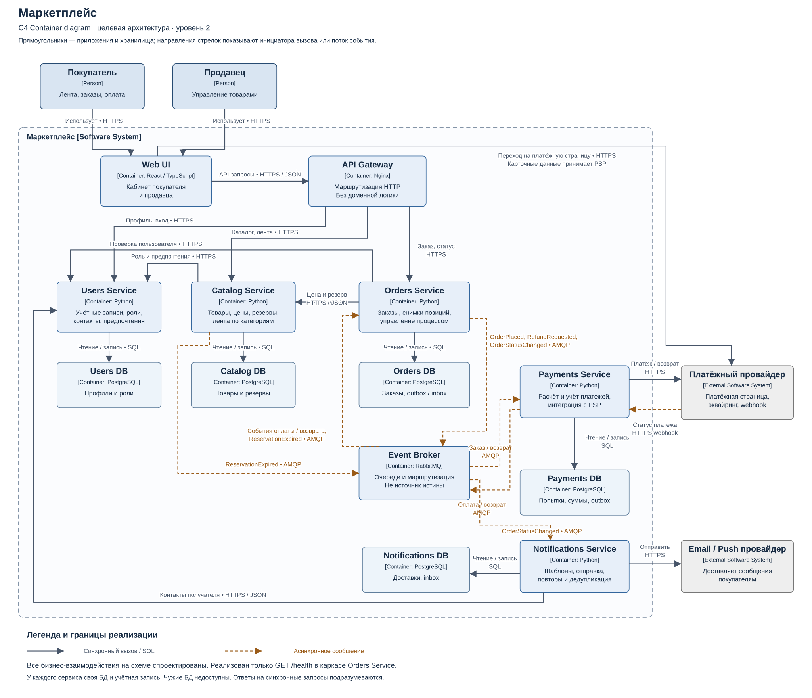

# Маркетплейс — проектирование архитектуры

Практика 1.2, домашнее задание 1. Спроектирована система из пяти доменных сервисов: Users, Catalog, Orders, Payments и Notifications. Реализован **только технический каркас Orders Service** с `GET /health`. Бизнес-логики, БД и брокера в исполняемом приложении нет.

## Быстрый запуск в Docker

Требуются Docker Engine и `curl`. Команды выполняются из корня репозитория. Docker Compose и Python на хосте для этого способа не нужны.

```bash
docker build -t soa-hw1-orders:local .
docker run -d --name soa-hw1-orders \
  --read-only --cap-drop ALL --security-opt no-new-privileges \
  -p 127.0.0.1:18080:8080 soa-hw1-orders:local
curl -i http://127.0.0.1:18080/health
```

Ожидаемый ответ, помимо заголовков даты и сервера:

```http
HTTP/1.0 200 OK
Content-Type: application/json; charset=utf-8

{"status":"ok","service":"orders"}
```

В первые мгновения после `docker run` процесс ещё может запускаться: повторите запрос. Через несколько секунд проверьте встроенный healthcheck:

```bash
docker inspect --format '{{.State.Health.Status}}' soa-hw1-orders
docker logs soa-hw1-orders
```

Ожидаемый статус — `healthy`. Контейнер слушает `0.0.0.0:8080`, порт хоста — `127.0.0.1:18080`. Если хостовый порт занят, замените `18080` в `-p` и URL. Для остановки и удаления **контейнера этого проекта**:

```bash
docker stop soa-hw1-orders
docker rm soa-hw1-orders
```

Если имя уже занято предыдущим запуском, сначала выполните эти две команды. База данных и другие сервисы для `/health` не требуются. Healthcheck проверяет доступность HTTP-процесса, а не бизнес-процессы или готовность будущих зависимостей.

### Запуск на hse

Рабочая папка: `~/soa/hw1`. Сервис доступен с самого сервера. Для доступа с компьютера можно открыть SSH-туннель:

```bash
ssh -L 18081:127.0.0.1:18080 hse
```

После этого в другом локальном терминале: `curl -i http://127.0.0.1:18081/health`. Публично порт сервиса не публикуется.

### Вариант с Docker Compose

Нужен плагин Docker Compose v2 с поддержкой `--wait`. На hse плагин отсутствует, поэтому там проверяется основной способ выше.

```bash
PORT=18080 docker compose up --build --wait --wait-timeout 60
curl -i http://127.0.0.1:18080/health
docker compose ps
docker compose down
```

Сквозная автоматическая проверка сборки, запуска и ответа с последующей уборкой:

```bash
PORT=18082 sh scripts/check.sh
```

В GitHub Actions настроен этот сценарий и HTTP-тесты. Наличие workflow не означает, что он уже был запущен. На GitLab те же команды можно выполнить вручную; отдельный GitLab pipeline не добавлен.

### Без Docker и тесты

Нужен Python 3.10 или новее; внешних Python-зависимостей нет. В Docker используется Python 3.13.

```bash
HTTP_PORT=18080 python3 services/orders/app.py
# В другом терминале:
curl -i http://127.0.0.1:18080/health
python3 -m unittest discover -s services/orders -p 'test_*.py' -v
```

`HTTP_PORT` задаёт порт процесса (по умолчанию 8080). `PORT` в Compose задаёт только порт хоста. `/orders`, `/payments` и неизвестные GET-пути возвращают 404. `http.server` выбран для небольшого учебного каркаса; перед разработкой промышленного API серверный стек потребуется пересмотреть.

## C4 Container



[Открыть PNG](docs/diagrams/container.png) · [Редактируемый PlantUML](docs/diagrams/container.puml)

Диаграмма показывает целевую архитектуру: людей, границу маркетплейса, приложения, отдельные хранилища, внешние системы и подписанные связи. C4 Container — приложение или хранилище, а не обязательно Docker-контейнер. SVG и PNG имеют фиксированную компоновку для чтения; PlantUML содержит ту же модель и при рендеринге размещает элементы автоматически. Для исходника нужен PlantUML со стандартной библиотекой C4 (`!include <C4/C4_Container>`).

## Домены и владение данными

| Сервис | Ответственность | Собственная БД |
|---|---|---|
| Users | Покупатели и продавцы, роли, контакты, предпочтения | Users DB — PostgreSQL |
| Catalog | Товары, цены, остатки и резервы, лента по категориям | Catalog DB — PostgreSQL |
| Orders | Состав и статус заказа, снимки позиций, координация | Orders DB — PostgreSQL |
| Payments | Расчёт суммы, попытки, учёт платежей и возвратов, PSP | Payments DB — PostgreSQL |
| Notifications | Шаблоны, задания доставки, повторы и дедупликация | Notifications DB — PostgreSQL |

Каждый сервис имеет собственные учётные данные БД. Прямой SQL к чужим таблицам запрещён. Идентификаторы и исторические снимки передаются по контрактам. Синхронные запросы используют HTTPS/JSON, события — RabbitMQ/AMQP; ответ PSP приходит через webhook. Полная таблица связей и сценарий оформления находятся в [описании архитектуры](docs/architecture.md).

Лента сначала показывает товары категорий, выбранных пользователем, затем остальные; внутри групп — новые товары первыми. Для гостя или при недоступности предпочтений применяется обычная выдача. ML не требуется. Цены и резервы принадлежат Catalog; сумма оплаты рассчитывается Payments по доверенному снимку заказа в копейках, а не по данным браузера.

## Решение и альтернативы

Рассмотрены модульный монолит, пять сервисов и семь сервисов с отдельными Inventory и Feed. Выбраны пять: платежи и уведомления имеют независимые процессы и сбои, заказ координирует их, а простой ленте и резервам пока достаточно Catalog. Цена решения — сетевые отказы, отложенная согласованность, идемпотентность и компенсации. Для небольшого реального MVP монолит мог бы быть дешевле; нагрузка и размер команды в кейсе не заданы.

Сравнение плюсов, минусов и условий пересмотра: [ADR-001](docs/adr/001-decomposition.md).

## Материалы и критерии

| Критерий задания | Где подтверждён |
|---|---|
| 1. C4 Container — 2 балла | [Диаграмма](docs/diagrams/container.svg), исходник и PNG |
| 2. Docker и `/health` — 2 балла | [Код](services/orders/app.py), Dockerfile, команды выше, [протокол](docs/verification.md) |
| 3. Домены — 1 балл | Таблица выше и [архитектура](docs/architecture.md) |
| 4. Домены по сервисам — 1 балл | Раздел «Почему домены распределены так» в архитектуре |
| 5. Владение и взаимодействия — 1 балл | Отдельные БД на C4, таблица связей и правила владения |
| 6. Альтернативы — 1 балл | Три варианта в ADR-001 |
| 7. Trade-off’ы — 1 балл | Плюсы и конкретные компромиссы каждого варианта в ADR-001 |
| 8. Финальный выбор — 1 балл | Решение и обоснование в ADR-001 |

Таблица сопоставляет материалы критериям; итоговую оценку выставляет преподаватель.

- [Отчёт](docs/report.md) и [отчёт в Word](docs/report.docx).
- [Подготовка к защите](docs/defense.md): доклад, демонстрация, 25 вопросов и шпаргалка.
- [Фактические проверки](docs/verification.md) и исходные логи в `docs/verification/`.
- [Как сдать через GitHub или GitLab](docs/submission.md).

## Источники

Определения и нотация сверены с [C4 Container](https://c4model.com/diagrams/container) и [C4 notation](https://c4model.com/diagrams/notation). Dockerfile и запуск опираются на [официальную документацию Dockerfile](https://docs.docker.com/reference/dockerfile/) и [Compose up](https://docs.docker.com/reference/cli/docker/compose/up/). Ограничения выбранного HTTP-сервера описаны в [документации Python](https://docs.python.org/3.13/library/http.server.html). Механизм надёжной публикации событий основан на [Transactional outbox](https://microservices.io/patterns/data/transactional-outbox.html). Эти механизмы описаны в архитектуре, но не реализованы в каркасе.
