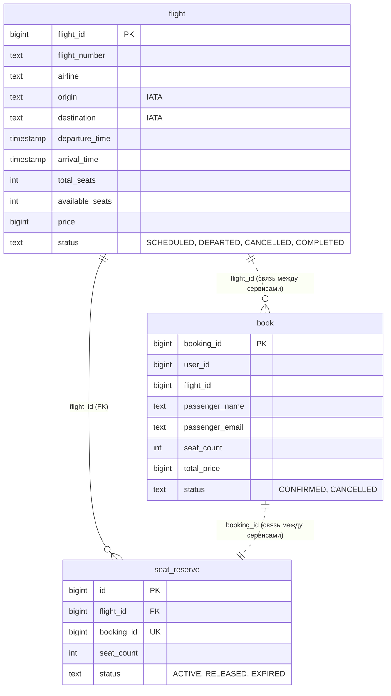

# Схема данных

Booking Service хранит `book` в своей PostgreSQL.
Flight Service хранит `flight` и `seat_reserve` в другой PostgreSQL.



Все поля — `NOT NULL`. Цены хранятся в копейках.
Время хранится в UTC в полях `timestamp without time zone`.
Статусы ограничены указанными значениями через `CHECK`.

Ограничения:

- `flight`: `total_seats > 0`, `price > 0`, `0 <= available_seats <= total_seats`.
- `flight`: `arrival_time > departure_time`; аэропорты различаются,
  каждый IATA-код состоит из трёх заглавных латинских букв.
- `flight`: номер рейса и дата вылета в UTC вместе уникальны.
- `book`: `seat_count > 0`, `total_price > 0`.
- `seat_reserve`: `seat_count > 0`, `flight_id` ссылается на `flight.flight_id`.
- `seat_reserve.booking_id` уникален: одному бронированию соответствует одна резервация.

Уникальность номера и даты рейса задаётся индексом без дополнительного поля даты:

```sql
CREATE UNIQUE INDEX flight_number_date_unique
ON flight (flight_number, (departure_time::date));
```

Пунктирные связи между БД — по ID, без SQL-внешних ключей.
`book.flight_id` позволяет получить рейс через gRPC; резервация находится по
`seat_reserve.booking_id = book.booking_id`,
поэтому поле `seat_reserve_id` в `book` не нужно.
Бронирование сохраняется только после успешного `ReserveSeats`.
При создании бронирования `total_price = seat_count * flight.price`; затем эта сумма не меняется.

3NF: поля атомарны и зависят от ключа своей таблицы, транзитивных зависимостей нет.
Данные рейса не копируются в бронирование. `passenger_name` и `passenger_email` —
данные пассажира конкретного бронирования, а `user_id` — пользователь, который его создал.
