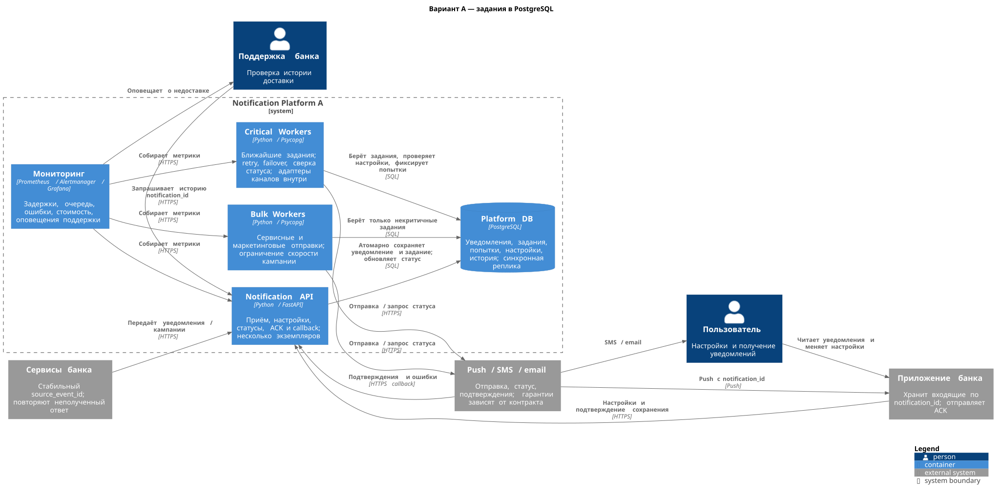
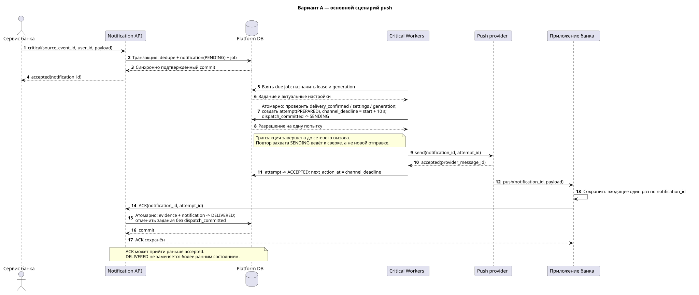
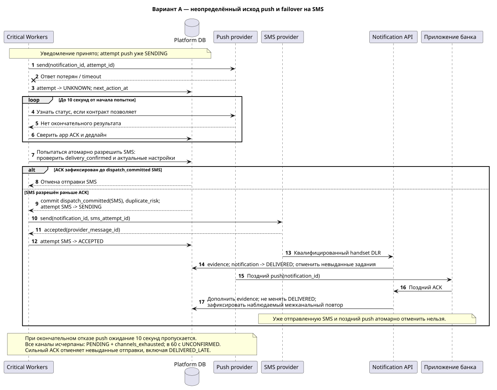
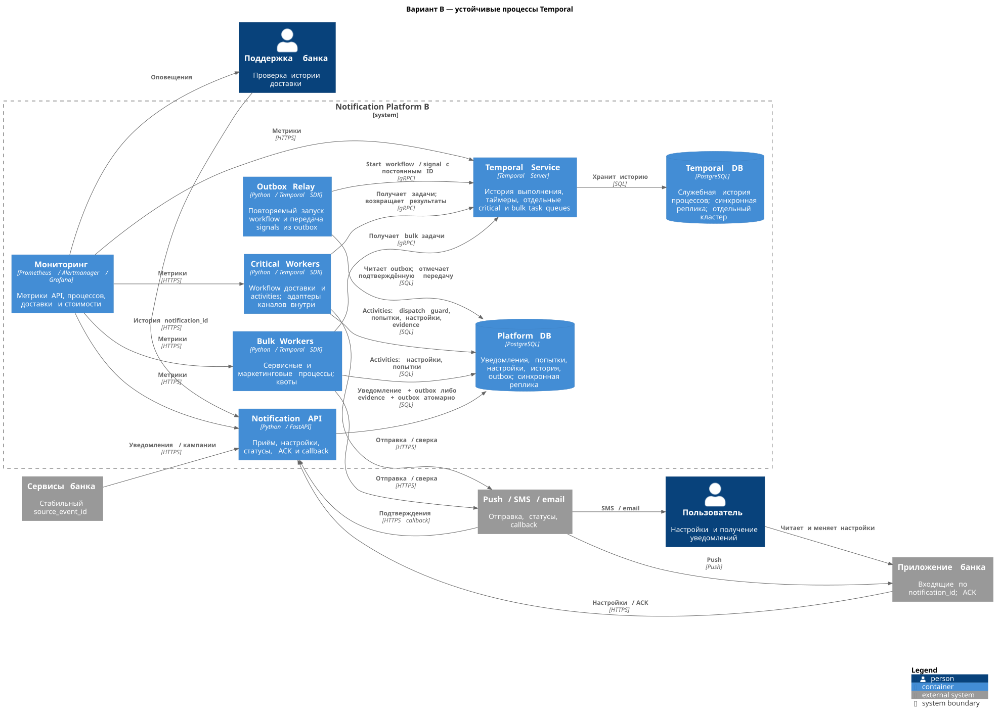
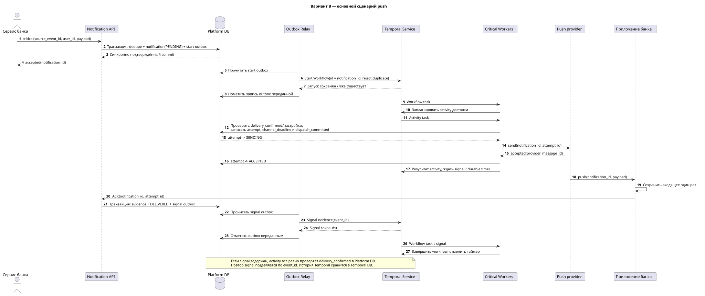
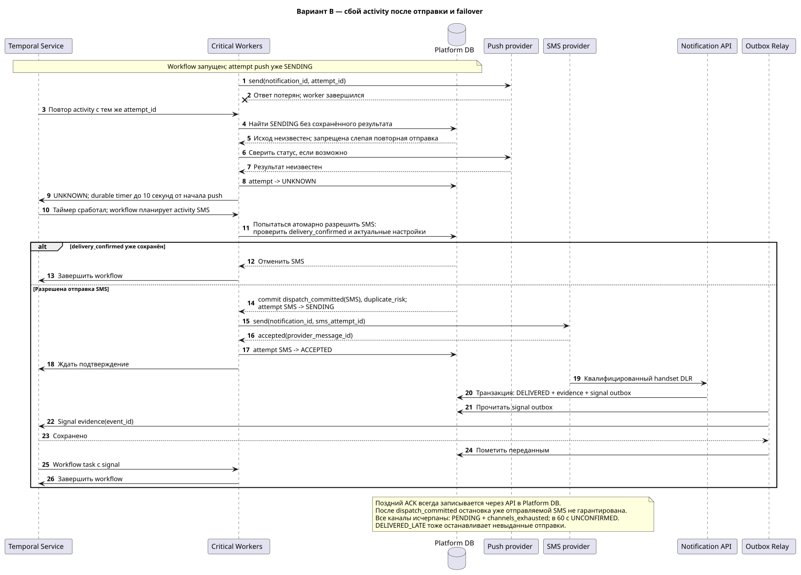

# RFC: критичная доставка с автоматическим failover

| Метаданные | Значение |
| --- | --- |
| Статус | DRAFT |
| Автор(ы) | Автор учебной работы; ФИО не указано |
| Ответственный | Не назначен |
| Бизнес-заказчик | Онлайн-банк, учебный кейс |
| Ревьюеры | Не назначены |
| Дата создания | 2026-11-10 |
| Дата обновления | 2026-11-17 |

## Оглавление

1. [Контекст](#контекст)
2. [Продуктовый анализ](#продуктовый-анализ)
3. [Пользовательские сценарии](#пользовательские-сценарии)
4. [Статистика](#статистика)
5. [Требования](#требования)
6. [Варианты решения](#варианты-решения)
7. [Сравнительный анализ](#сравнительный-анализ)
8. [Выводы](#выводы)
9. [Связанные задачи](#связанные-задачи)
10. [Приложения](#приложения)

## Контекст

Разрозненная отправка в банке вызывает задержки и дубли. Единая платформа обслуживает транзакционные, сервисные и маркетинговые уведомления через push, SMS и email.

### Ключевые вопросы

Что считать доставкой? Когда включать резерв? Как защитить критичные от кампании?

## Продуктовый анализ

| ID | Цель |
| --- | --- |
| BR01 | Увеличить retention на 15% |
| BR02 | Снизить жалобы на 30% |
| BR03 | Обеспечить доставку критичных уведомлений |

Проценты считаем относительными; базы и период сравнения нужно согласовать. Влияние платформы на retention проверяется экспериментом.

## Пользовательские сценарии

| Приоритет | Тип | Участник | Сценарий |
| --- | --- | --- | --- |
| MUST HAVE | Доставка | Клиент | Получает сообщение об операции; при отказе основного канала используется резерв |
| MUST HAVE | Настройки | Клиент | Отключает необязательное, выбирает предпочтение |
| MUST HAVE | Контроль | Поддержка | Видит историю и недоставку |
| SHOULD HAVE | Кампания | Команда банка | Отправляет до 1 млн сообщений с приоритетом критичных |

MUST HAVE — обязательно, SHOULD HAVE — желательно. При конфликте замедляем маркетинг; настройками и сохранностью не жертвуем.

## Статистика

Из задания: MAU 10 млн, DAU 3 млн, одновременно активных 300 000; в сутки на пользователя 2 транзакционных + 3 сервисных + 5 маркетинговых сообщений. Одновременные пользователи ≠ запросы/с.

## Требования

### Функциональные требования

| № | Приоритет | Обозначение | Требование |
| --- | --- | --- | --- |
| 1 | MUST HAVE | FR01 | Принимать и отправлять три типа уведомлений через push, SMS и email |
| 2 | MUST HAVE | FR02 | Учитывать настройки и предпочтение пользователя |
| 3 | MUST HAVE | FR03 | Доставлять критичные с повтором/резервом; показывать результат и историю |
| 4 | MUST HAVE | FR04 | Повтор запроса возвращает прежнее уведомление |
| 5 | SHOULD HAVE | FR05 | Выполнять кампанию до 1 млн адресатов |

### Нефункциональные требования

Числа — предлагаемые цели, не результаты испытаний. Обоснования и проверки — в [п. 2 ответа](REQUIREMENTS.md#2-пять-нефункциональных-требований).

| № | Приоритет | Обозначение | Требование |
| --- | --- | --- | --- |
| 1 | SHOULD HAVE | NFR01 | Устойчивый приём → сохранённое подтверждение приложения: p95 ≤ 2 с при исправном push первым каналом, доступном приложении и нагрузке NFR03 |
| 2 | MUST HAVE | NFR02 | ≥99,9% подходящих принятых критичных подтверждены за 60 с; календарный месяц |
| 3 | SHOULD HAVE | NFR03 | 3 750 уведомлений/с; первая передача/пропуск кампании ≤1 ч при исправных каналах и достаточных квотах |
| 4 | MUST HAVE | NFR04 | 0 внутренних дублей одного запроса за 7 суток; после сильного подтверждения нет новых разрешений отправки |
| 5 | MUST HAVE | NFR05 | История для 100% принятых; после 60 с без подтверждения оповещение ещё за ≤60 с |

**Расчёт нагрузок:** по DAU — 30 млн/сутки = 347,22/с. Допущения: пик ×10 и дополнительная кампания 1 млн/час → **3 750/с**. С повторами/резервом ×1,3 → **4 875 отправок/с**, плюс подтверждения и сверки. Критичный пик ≈695/с; полный переход на SMS требует такой же квоты до повторов. При аварии маркетинг ждёт.

### Архитектурно значимые требования

| ASR, приоритет | Связь | Последствие и компромисс |
| --- | --- | --- |
| ASR01, MUST: доставка при сбоях | BR03 → FR03 → NFR02/05 | Устойчивые задания, репликация, история; больше ресурсов |
| ASR02, SHOULD: скорость под нагрузкой | BR01/03 → FR01/03/05 → NFR01/03 | Раздельные пулы и квоты; маркетинг замедляется |
| ASR03, MUST: защита от повторов | BR02/03 → FR03/04 → NFR04 | Ключи и сверка; ожидание снижает риск дубля, но задерживает резерв |

## Варианты решения

### Общие правила доставки

- **Приём:** источник хранит событие до передачи; платформа отвечает accepted только после устойчивой записи уведомления и работы. Входной ключ `(источник, событие, получатель, тип)` хранится 7 суток.
- **Маршрут:** push → SMS → email; разрешённое предпочтение первым. Сервисные/маркетинговые отключаются, у критичных остаётся подтверждаемый канал. Настройки проверяются при разрешении отправки; начатое не отзывается.
- **Успех:** ACK сохранения приложением или достоверный SMS-отчёт телефона. Ответ провайдера и приём email сервером недостаточны. Нужны достижимый разрешённый канал, контакт, квота и подтверждения. NFR02 считает принятые критичные с таким контактом при приёме; последующие отказы остаются в знаменателе. Остальные считаются отдельно, последняя минута месяца досчитывается после её завершения.
- **Резерв:** доказанный отказ — сразу; временный отказ до принятия — один безопасный повтор. Потеря ответа/сбой после send — `UNKNOWN` и сверка. Повтор допустим при доказанной неотправке либо идемпотентности провайдера с прежним ключом. Через 10 с от начала канала разрешён резерв с риском дубля; восстановление не перезапускает этот срок.
- **Итог:** сильное подтверждение до 60 с — `DELIVERED`, позже — `DELIVERED_LATE`; оба останавливают невыданные отправки. До срока исчерпание каналов оставляет `PENDING` с причиной; в 60 с без подтверждения — `UNCONFIRMED` и оповещение. Если каналы исчерпаны, новые отправки не планируются; проблему разбирает поддержка. Поздние ACK принимаются 7 суток. Уже отправленная SMS не отзывается, абсолютное отсутствие межканальных дублей не обещается.

Callback проверяется и применяется один раз. Поддержка видит историю; мониторинг показывает задержки, очереди, ошибки и отправки по каналам. Это позволяет выявлять недоставку и лишние расходы на SMS.

### Вариант 1: задания в PostgreSQL

#### Архитектура

**FastAPI → PostgreSQL** атомарно сохраняет уведомление и задание. Отдельные **Python/Psycopg**-обработчики обслуживают critical/bulk; кампании ограничены по скорости. Брокер не нужен. **Prometheus/Alertmanager/Grafana** дают метрики и оповещения. Адаптеры **FCM/Twilio/SES** встроены в обработчики; квоты и подтверждения провайдеров требуют проверки.

Задание имеет владельца и сохранённый таймер; устаревший обработчик не может переписать состояние. Сеть вне транзакции. После сбоя `SENDING` сверяется, а не отправляется заново. API/обработчики дублируются; PostgreSQL имеет синхронную реплику и безопасное переключение через **Patroni/etcd**. При отсутствии безопасной записи нет accepted.

#### Этапы реализации

Сроки — учебные оценки для сравнения.

| Этап | Описание | Планируемый срок | Ресурсы | Риски |
| --- | --- | --- | --- | --- |
| 1 | Приём, задания, адаптеры | 1–2 недели | 1 разработчик | Ошибки переходов |
| 2 | Резервирование, мониторинг, тесты | 1 неделя | Разработчик + эксплуатация | Нагрузка БД и квоты |

#### Преимущества

Меньше компонентов, атомарный приём.

#### Недостатки

Собственный планировщик; общая БД может стать узким местом.

### Вариант 2: процессы Temporal

#### Архитектура

Те же API, Platform DB и каналы. API сохраняет уведомление и **outbox** — работу для последующей передачи. Relay запускает процесс **Temporal Server/Python SDK** с `workflow_id = notification_id`; повторный запуск подавляется. История процессов хранится в отдельном **PostgreSQL**; очереди и обработчики critical/bulk разделены.

Callback атомарно сохраняет подтверждение и outbox-сигнал; relay передаёт его процессу. Каждый шаг проверяет Platform DB перед send, поэтому задержанный сигнал не вызывает лишнюю отправку. Повтор шага сверяет `SENDING`; Temporal не исключает внешние дубли. Оба хранилища резервируются, Temporal/relay работают несколькими экземплярами.

#### Этапы реализации

| Этап | Описание | Планируемый срок | Ресурсы | Риски |
| --- | --- | --- | --- | --- |
| 1 | Temporal, outbox, процессы | 2–3 недели | 1 разработчик + эксплуатация | Освоение технологии |
| 2 | Резервирование, сигналы, тесты | 1 неделя | Та же команда | Задержки и размер истории |

#### Преимущества

Готовые устойчивые таймеры и восстановление процессов.

#### Недостатки

Дополнительные сервис и БД; сложнее эксплуатация.

## Сравнительный анализ

### Ресурсные требования

| Критерий | Вариант 1 | Вариант 2 |
| --- | --- | --- |
| Время, допущение | 2–3 недели | 3–4 недели |
| Команда | Разработчик + помощь эксплуатации | То же, нужны знания Temporal |
| Инфраструктура | API, обработчики, PostgreSQL, мониторинг | Дополнительно Temporal, его БД и relay |
| Организационный риск | Поддержка планировщика | Эксплуатация Temporal |

### Соответствие требованиям

| Требование | Вариант 1 | Вариант 2 |
| --- | --- | --- |
| ASR01: FR03, NFR02/05 | Устойчивые задания, репликация, история | Outbox, история процесса, репликация |
| ASR02: FR01/03/05, NFR01/03 | Отдельные пулы и квоты, ограничение кампаний | Отдельные очереди/пулы и квоты |
| ASR03: FR03/04, NFR04 | Уникальные ключи и сверка попыток | Те же ключи + уникальный процесс |

Оба варианта проверяют настройки FR02 и используют одинаковый порядок каналов. Выполнение целей нужно подтвердить испытаниями.

## Выводы

**Рекомендация — вариант 1:** меньше инфраструктуры для трёх каналов. Цена — собственный планировщик и проверка мощности БД. Ради критичных замедляем маркетинг и допускаем дорогую SMS; при неизвестном исходе принимаем риск межканального дубля.

## Связанные задачи

Трекер не задан. Контракты провайдеров → прототип → тесты нагрузки и сбоев → пилот. Затем мониторить и актуализировать требования. [Ответы по пунктам задания](REQUIREMENTS.md).

## Приложения

### Глоссарий

| Термин | Значение |
| --- | --- |
| Failover / retry | Резервный канал / повтор в том же канале |
| ACK / callback | Подтверждение приложения / обратный вызов провайдера |
| Идемпотентность | Повтор не создаёт второй логический результат |
| Worker / bulk | Обработчик / некритичный массовый поток |
| Workflow / activity | Процесс Temporal / его исполняемый шаг |

PlantUML: [A C4](diagrams/a-container.puml), [A основной](diagrams/a-main.puml), [A failover](diagrams/a-failover.puml), [B C4](diagrams/b-container.puml), [B основной](diagrams/b-main.puml), [B failover](diagrams/b-failover.puml).

[Лекция 8](sources/lecture-8.pdf) · [Шаблон](sources/rfc-template.md) · [Условие](sources/assignment.txt).
